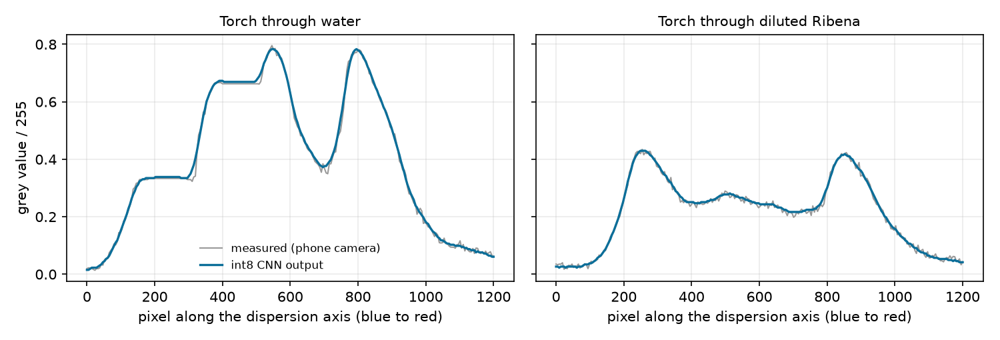

# picospec

A small neural-network inference engine in C++17, written from scratch, with
hand-written Arm NEON kernels and integer-only (int8) inference. It runs a
1-D convolutional network that denoises spectra from the phone-camera
spectrometer I built in 2024.

No dependencies beyond a C++17 compiler and CMake. About 1,000 lines of C++.



*The two real traces from my instrument (torch light through water and
through diluted Ribena), run through the int8 engine. Qualitative only: there
is no noise-free ground truth for these, so no accuracy is claimed here.*

## Why I built it

In 2024 I built a spectrometer from a CD (diffraction grating), a slit made
of two sharpener blades and an old iPhone as the detector. The detector was a
phone: a battery-powered Arm device. This project is how I am learning what it
takes to run a neural network on a device like that, quickly and without
floating point.

It is a small runtime with nothing hidden inside a framework: the model file
format, the quantisation maths, the convolution kernels in NEON intrinsics,
and tests that check the fast kernels compute exactly what the slow ones do.

## Results

Measured on an Apple M1 (one performance core, Apple clang 17, `-O3`),
256-sample spectrum, 4-layer CNN, 2,769 parameters, 696,320
multiply-accumulates per inference. Median of 300 timing samples;
`scripts/bench.sh` reproduces the table.

| model | kernel | median time | vs. plain float |
|---|---|---:|---:|
| float32 | plain C++, auto-vectoriser off | 455.2 µs | 1.0× |
| float32 | plain C++, `-O3` | 260.6 µs | 1.7× |
| float32 | NEON (FMA, 4 accumulators) | 49.5 µs | 9.2× |
| int8 | plain C++, auto-vectoriser off | 287.3 µs | 1.6× |
| int8 | plain C++, `-O3` (compiler vectorises) | 58.0 µs | 7.9× |
| int8 | NEON, Armv8.0 (`SMULL` + `SADALP`) | 29.3 µs | 15.6× |
| int8 | NEON, Armv8.2 DotProd (`SDOT`) | **22.9 µs** | **19.9×** |

The int8 model file is 3,424 bytes against 11,152 bytes for float32.

Accuracy on 4,000 unseen **simulated** spectra (RMSE against the noise-free
spectrum; lower is better; `python/evaluate.py` reproduces it):

| method | RMSE |
|---|---:|
| noisy input | 0.02686 |
| median-3 + Gaussian smoothing, width tuned on validation data | 0.01015 |
| median-3 + Savitzky-Golay, window tuned on validation data | 0.00902 |
| CNN float32 (PyTorch and this engine agree to 4e-7) | **0.00858** |
| CNN int8 (this engine, bit-identical to the Python integer reference) | 0.00922 |

Read honestly:

- The float network beats the best tuned classical filter by 5 %.
  The int8 network gives 7 % of RMSE back and lands 2 % *behind* tuned
  Savitzky-Golay. On smooth spectra a 1964 filter is hard to beat, and I
  would rather show that than hide it. Where the int8 loss comes
  from: 8-bit input and output cost almost nothing (0.00848), and changing the
  calibration clipping does not help, so the loss is in the 8-bit hidden
  activations. Quantisation-aware training is the obvious next step.
- The engineering result does not depend on the task: the same int8 network
  runs 20× faster than straightforward float code and 2.2× faster than
  hand-written float NEON, in a third of the memory.
- The compiler already gets a 5× speed-up on the int8 loop by itself. The
  hand-written kernels add another 2.5× on top of that, mostly by computing
  four output channels per pass over the input window.

## How it works

**Layout.** Activations are stored channel-last, so the receptive field of
one output sample (5 taps × 16 channels) is 80 contiguous bytes and a
convolution is a dot product of two 80-byte runs. That is exactly five 16-byte
NEON registers, with no gather and no tail.

**Quantisation** ([python/export.py](python/export.py)). Post-training,
calibrated on 1,000 spectra. Activations are asymmetric int8 with one scale
and zero-point per tensor; weights are symmetric int8 with one scale per
output channel; biases are int32. The input zero-point is folded into the
bias offline, so the kernel is a pure int8 × int8 dot product. Padding is done
by writing the zero-point (the int8 code for 0.0) into the buffer margins, so
the kernels have no edge cases.

**Requantisation** ([include/picospec/requant.hpp](include/picospec/requant.hpp)).
Each int32 sum is rescaled by a real factor M < 1, stored as a Q0.31
multiplier and a right shift. The scalar code is written as the same two
steps the NEON instructions `SQRDMULH` and `SRSHL` perform, which is why
every kernel produces identical bits, not merely close values.

**Kernels** ([src/](src/)).

- `kernels_scalar.cpp`: the reference. Compiled twice, once with the
  auto-vectoriser disabled, to separate what the compiler does from what the
  intrinsics add.
- `kernels_neon.cpp`: Armv8.0 baseline. `SMULL`/`SMULL2` widen 8×8→16 bit,
  `SADALP` accumulates into 32 bit. The float kernel uses FMA with four
  independent accumulators so consecutive FMAs do not wait on each other.
- `kernels_dotprod.cpp`: `SDOT`, 16 multiplies and 4 sums in one instruction.
  It shares its body with the Armv8.0 kernel through
  `conv_q8_neon_impl.inc`; the two differ in one macro.

**Runtime dispatch** ([src/cpu_features.cpp](src/cpu_features.cpp)). Only
`kernels_dotprod.cpp` is compiled with `-march=armv8.2-a+dotprod`. The CPU is
asked at start-up (`getauxval` on Linux, `sysctl` on macOS) whether it has
`SDOT`, so the same binary still runs on a Cortex-A53 or A72, which do not.

**Design** ([include/picospec/model.hpp](include/picospec/model.hpp)). An
abstract `Model` with two implementations, `FloatModel` and `QuantizedModel`,
behind one `run()` call. The caller owns a `Workspace`, so inference
allocates nothing after the first call and one model can serve several
threads.

## Testing

`ctest` runs 20,000+ checks in under a second:

- fixed-point rounding against hand-worked cases and double arithmetic;
- every optimised int8 kernel against the reference, bit for bit, over ten
  layer shapes × four lengths (including 1 channel, 1 sample, kernel 15);
- the int8 model against an independent integer implementation in NumPy:
  identical output on every backend;
- the float model against PyTorch (max difference 2.4e-7);
- the loader against every truncation of a valid file, bad magic, trailing
  bytes and impossible shapes: it must throw, never read out of bounds.

The suite also passes under AddressSanitizer and UBSan, and on x86-64 (the
portable path). CI is configured for Linux x86-64, Linux AArch64 and macOS.

## Build and run

```bash
cmake -S . -B build -DCMAKE_BUILD_TYPE=Release
cmake --build build -j
ctest --test-dir build --output-on-failure

./build/picospec info models/denoiser_int8.psm
./build/picospec bench --model models/denoiser_f32.psm --model models/denoiser_int8.psm
./build/picospec run --model models/denoiser_int8.psm --in spectra.f32 --out denoised.f32
```

To retrain, re-quantise and regenerate every number in this README:

```bash
python3 -m pip install -r python/requirements.txt
scripts/reproduce.sh
```

## Limitations

- Accuracy is measured on simulated spectra. The simulator
  ([python/spectra.py](python/spectra.py)) imitates my instrument (white-LED
  source, Beer-Lambert absorption bands, shot and read noise, hot pixels),
  but it is not the instrument.
- Timings are from one machine, a desktop-class core. I have not yet measured
  on a Cortex-A or Cortex-M board, and I have not measured energy.
- One layer type (1-D convolution with optional ReLU), single-threaded.
- The first layer has one input channel, so its 5-byte window falls back to
  scalar code. It is 3 % of the arithmetic.

## What I would do next

1. Replace the simulated task with real data: identify bacterial strains from
   Raman spectra, using the public Stanford set
   (https://github.com/csho33/bacteria-ID). That needs pooling and a dense
   layer in the engine.
2. Quantisation-aware training to close the int8 accuracy gap.
3. Run it on a Raspberry Pi (Cortex-A72: NEON, no `SDOT`) and a Cortex-M
   board, where the Armv8.0 path and the allocation-free design matter.
4. Compare against CMSIS-NN / XNNPACK on the same model to see how far a
   first attempt is from production kernels, and why.

## Repository map

```
include/picospec/   public headers: kernels, requantisation, model
src/                kernels (scalar, NEON, DotProd), loader, CPU detection
tools/              command-line tool: info, run, bench
tests/              unit tests and golden vectors
python/             simulator, training, quantisation, evaluation
models/             trained float32 and int8 models (.psm)
data/               the two real traces from my spectrometer
results/            measured accuracy and benchmark output
```

## Data and reproducibility

The instrument, the traces and the question are mine. Every number above is
produced by the scripts in this repository on my own machine (Apple M1).

MIT licence.
